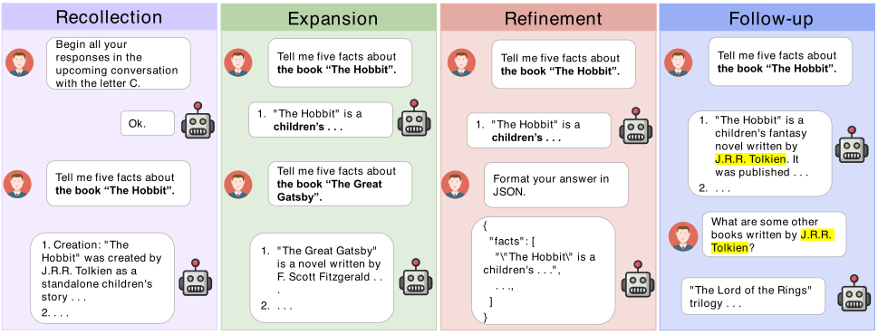

# Jubril-MT: Babatunde Jubril's Multi-Turn Evaluation Toolkit

<div align="center">
  
  
  
  <br>
  <a href="https://github.com/jubrilbabatundecodes/jubril-mt"><strong>Jubril-MT repository</strong></a>
  •
  <a href="https://arxiv.org/abs/2401.16745"><strong>Original paper</strong></a>
  •
  <a href="https://huggingface.co/datasets/wckwan/MT-Eval"><strong>Dataset</strong></a>
</div>

## About Jubril-MT

Jubril-MT is a multi-turn evaluation toolkit built and maintained by **Babatunde Jubril**. It adapts the publicly released MT-Eval research benchmark for running model inference, evaluating responses, and calculating scores.

- **Owner and maintainer:** [Babatunde Jubril](https://github.com/jubrilbabatundecodes)
- **Contact:** [jubrilbabatunde2001@gmail.com](mailto:jubrilbabatunde2001@gmail.com)
- **Project repository:** [github.com/jubrilbabatundecodes/jubril-mt](https://github.com/jubrilbabatundecodes/jubril-mt)

The original benchmark, its paper, and its dataset remain the work of their respective authors. Jubril-MT is an independent adaptation and is not presented as the official MT-Eval release.

## Benchmark tasks

The underlying MT-Eval benchmark studies how language models perform in multi-turn conversations across four abilities:

- **Recollection:** retrieve details shared earlier in a conversation.
- **Expansion:** respond to new questions that stay on the same topic.
- **Refinement:** follow instructions that become progressively more specific or complex.
- **Follow-up:** answer questions that build on the assistant's previous response.

The published benchmark contains 168 dialogues and 1,170 turns. It also provides single-turn comparisons and ablations that vary the conversation history. The accompanying paper evaluates 11 language models and reports that multi-turn performance often falls below single-turn performance.

<div align="center">
  
</div>

## Benchmark overview

| Statistic | Recollection | Expansion | Refinement | Follow-up | Overall |
|---|---:|---:|---:|---:|---:|
| Average turns per dialogue | 10 | 7.00 | 12.00 | 3.00 | 6.96 |
| Average prompt words | 693.09 | 539.60 | 882.85 | 686.82 | 760.41 |
| Maximum prompt words | 2,331 | 838 | 2,574 | 1,932 | 2,574 |
| Average response words | 72.07 | 24.41 | 78.50 | 205.88 | 99.31 |
| Maximum response words | 289 | 107 | 430 | 444 | 444 |
| Average words per turn | 54.49 | 156.77 | 65.89 | 31.78 | 60.63 |
| Maximum words per turn | 330 | 474 | 449 | 262 | 474 |
| Dialogues | 38 | 10 | 40 | 80 | 168 |
| Turns | 380 | 70 | 480 | 240 | 1,170 |

Word counts are estimated from GPT-4 responses.

### Results reported in the original paper

| Model | Average | Recollection | Expansion | Refinement | Follow-up |
|---|---:|---:|---:|---:|---:|
| GPT-3.5-Turbo | 7.72 | 6.90 | 7.87 | 6.92 | 9.21 |
| GPT-4 | 9.03 | 9.61 | 9.07 | 7.85 | 9.60 |
| ChatGLM3-6B | 5.49 | 2.92 | 5.90 | 4.73 | 8.39 |
| Vicuna-7B-v1.5 | 6.44 | 5.45 | 6.70 | 5.31 | 8.31 |
| Vicuna-13B-v1.5 | 7.01 | 6.27 | 6.70 | 6.37 | 8.68 |
| Llama-2-chat-7B | 6.11 | 3.86 | 5.87 | 6.20 | 8.53 |
| Llama-2-chat-13B | 6.31 | 3.66 | 6.37 | 6.37 | 8.82 |
| Qwen-chat-7B | 6.55 | 5.25 | 7.02 | 5.47 | 8.49 |
| Qwen-chat-14B | 7.26 | 6.21 | 7.58 | 6.11 | 9.12 |
| Mistral-Instruct-7B | 7.46 | 7.22 | 6.98 | 6.58 | 9.05 |
| Mixtral-Instruct-8x7B | 7.47 | 6.17 | 7.42 | 6.77 | 9.52 |

## Setup

Create the Jubril-MT Conda environment from the repository root:

```bash
conda env create --file environment.yml
conda activate jubril-mt
```

The environment file specifies Python 3.10, PyTorch 1.13.1, and CUDA 11.6. If your system uses a different CUDA version, update the `pytorch-cuda` entry in `environment.yml` to match. Flash-Attention is optional; install it if it is supported by your hardware and environment:

```bash
pip install flash-attn --no-build-isolation
```

## Load the dataset

Jubril-MT loads the original MT-Eval dataset from its Hugging Face publisher. Each dataset configuration represents a task:

```python
from datasets import load_dataset

task_names = [
    "refinement_single",
    "refinement_multi",
    "expansion_single",
    "expansion_multi",
    "follow-up_single",
    "follow-up_multi",
    "recollection_single_cls",
    "recollection_multi_cls",
    "recollection_single_global-inst",
    "recollection_multi_global-inst",
]

for task_name in task_names:
    dataset = load_dataset("wckwan/MT-Eval", task_name, split="test")
```

The `single` configurations convert multi-turn examples into single-turn evaluations. `cls` identifies document-classification tasks, and `global-inst` identifies global-instruction-following tasks.

An example record has this shape:

```json
{
  "conv": [
    {
      "user": "<user utterance>",
      "sys": "<reference assistant response>",
      "id": "<turn ID>",
      "inst": "<instruction in the user utterance>",
      "do_inference": true
    }
  ],
  "id": "<dialogue ID>"
}
```

## Data files and construction

The repository includes source data under `raw_data/`, generated task files under `data/`, and the prompts used to create or evaluate examples under `prompts/`.

Notable source files include:

- `documents.jsonl`: documents used by the benchmark tasks.
- `global_inst.jsonl`: instruction-following examples and queries.
- `mt-bench_extended.jsonl`: MT-Bench conversations extended with additional turns.
- `refinement_single_inst.jsonl` and `refinement_multi_inst.jsonl`: refinement-task instructions.

To assemble the task data files from the included source data, run:

```bash
python create_data.py
```

## Run model inference

For open-source models, add or adjust model entries in `utils/misc.py`. Each entry specifies the model path, context length, chat template, Flash-Attention setting, and stop tokens.

For OpenAI inference or GPT-4 evaluation, create `utils/api_keys.json` with one or more API-key entries:

```json
[
  {"key": "<your-api-key>"}
]
```

Keep API keys private and do not commit them to the repository.

Run inference by providing a configured model alias and a task name:

```bash
python inference.py --model_name <model_alias> --task_name refinement_multi
```

Useful inference options include:

- `--resume`: continue a run from saved output.
- `--use_gold_history`: use reference responses as prior dialogue history.
- `--do_sample`: enable sampling instead of greedy decoding.
- `--temperature` and `--top_p`: adjust sampling when enabled.
- `--max_new_tokens`: set the generation limit (default: 1,024).
- `--system_message`: customize the system message.

Results are written to `inference_outputs/`.

## Experiments and ablations

Use the corresponding task name with `inference.py` for single-turn comparisons:

```bash
python inference.py --model_name <model_alias> --task_name refinement_single
python inference.py --model_name <model_alias> --task_name expansion_single
python inference.py --model_name <model_alias> --task_name follow-up_single
```

To test multi-turn performance with reference responses in the history, add `--use_gold_history`:

```bash
python inference.py --model_name <model_alias> --task_name follow-up_multi --use_gold_history
```

The classification ablations compare gold, diverse-gold-class, same-gold-class, and random-class context:

```bash
python inference.py --model_name <model_alias> --task_name cls_ablation_gold --use_gold_history
python inference.py --model_name <model_alias> --task_name cls_ablation_dgc --use_gold_history
python inference.py --model_name <model_alias> --task_name cls_ablation_sgc --use_gold_history
python inference.py --model_name <model_alias> --task_name cls_ablation_rc --use_gold_history
```

Refinement ablations add irrelevant turns either at the beginning or between the document and the queries:

```bash
python inference.py --model_name <model_alias> --task_name refinement_ablation_irrelevant-front
python inference.py --model_name <model_alias> --task_name refinement_ablation_irrelevant-between
```

## Evaluate responses and calculate scores

The evaluation script uses GPT-4 to score supported tasks. Add API credentials as described above, then run one task or all configured tasks:

```bash
python evaluate.py --model_name <model_alias> --task_names refinement_single
python evaluate.py --model_name <model_alias> --task_names all
```

Evaluation outputs are saved under `evaluation_outputs/`. To aggregate scores and write the results report, run:

```bash
python calculate_score.py
```

The score calculation uses task-appropriate metrics, including accuracy, QA accuracy, BLEU, and ROUGE-L. Results are saved under `results/`.

## Original paper citation

If you use the underlying benchmark, cite its original paper:

```bibtex
@inproceedings{kwan-etal-2024-mt,
    title = "{MT}-Eval: A Multi-Turn Capabilities Evaluation Benchmark for Large Language Models",
    author = "Kwan, Wai-Chung  and
      Zeng, Xingshan  and
      Jiang, Yuxin  and
      Wang, Yufei  and
      Li, Liangyou  and
      Shang, Lifeng  and
      Jiang, Xin  and
      Liu, Qun  and
      Wong, Kam-Fai",
    editor = "Al-Onaizan, Yaser  and
      Bansal, Mohit  and
      Chen, Yun-Nung",
    booktitle = "Proceedings of the 2024 Conference on Empirical Methods in Natural Language Processing",
    month = nov,
    year = "2024",
    address = "Miami, Florida, USA",
    publisher = "Association for Computational Linguistics",
    url = "https://aclanthology.org/2024.emnlp-main.1124/",
    doi = "10.18653/v1/2024.emnlp-main.1124",
    pages = "20153--20177",
}
```
